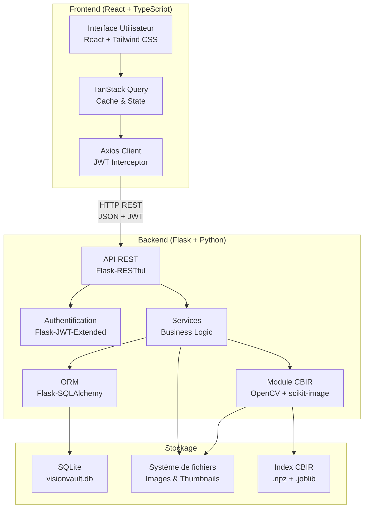
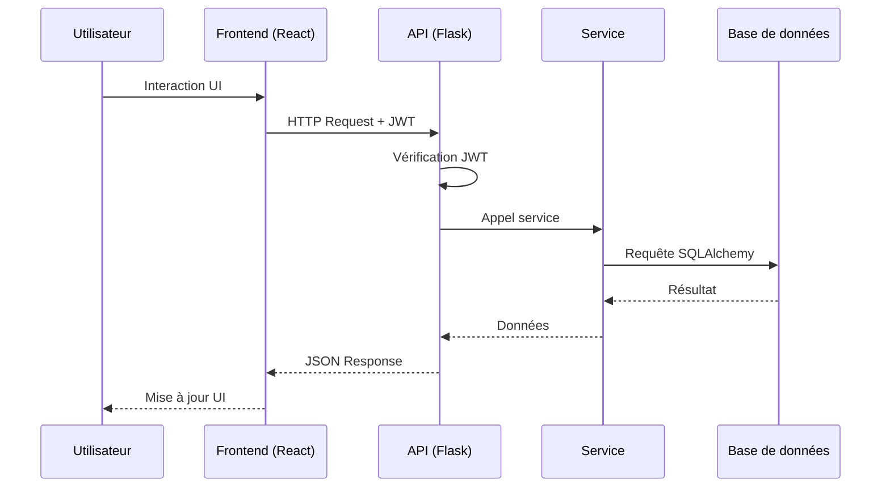
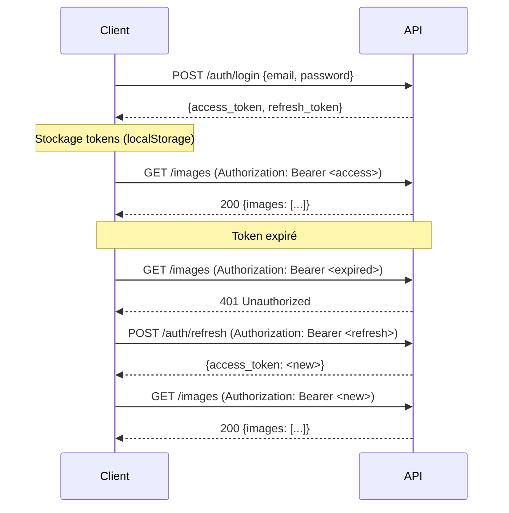
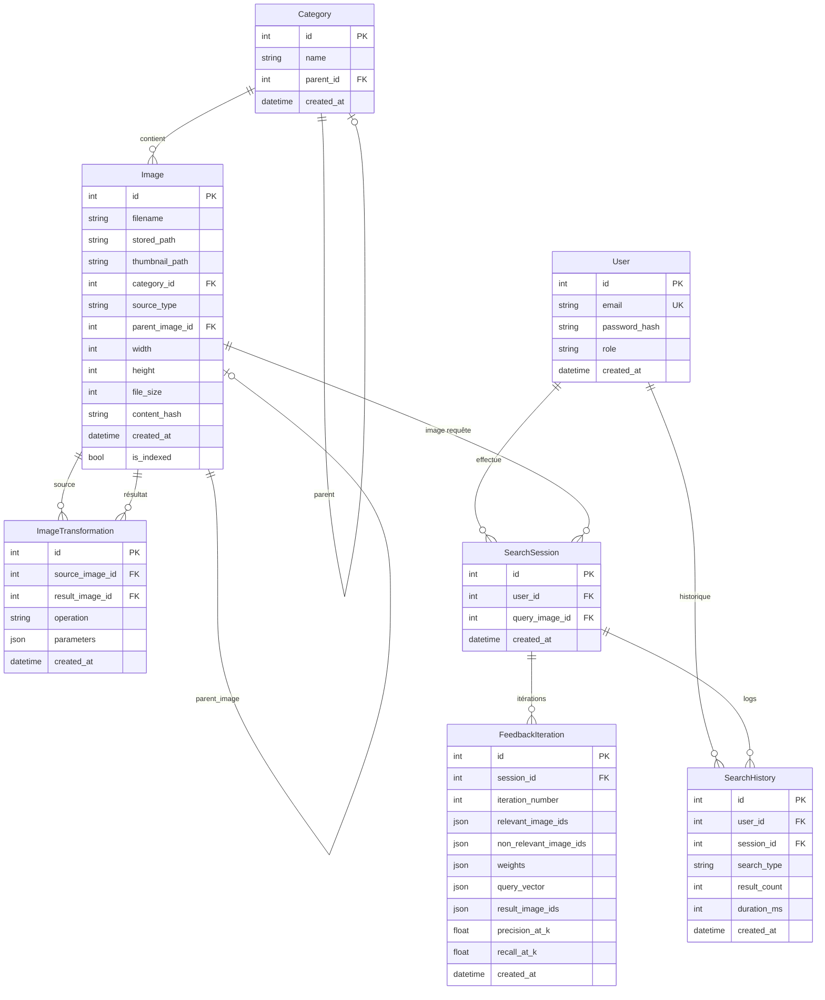
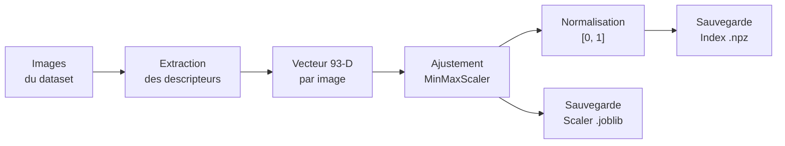
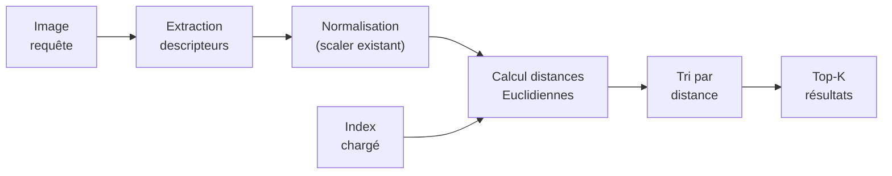
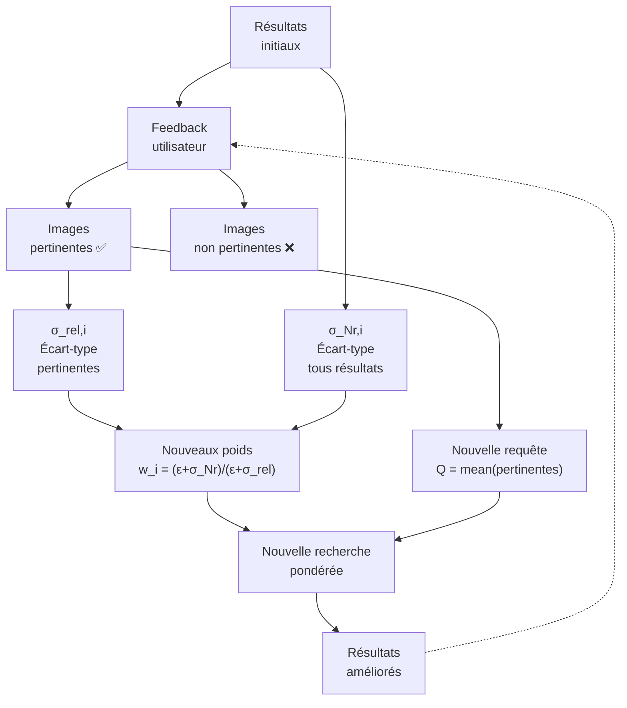

# VisionVault — Architecture du système

## Table des matières

1. [Architecture globale](#1-architecture-globale)
2. [Communication Frontend–Backend](#2-communication-frontendbackend)
3. [Schéma de la base de données](#3-schéma-de-la-base-de-données)
4. [Pipeline CBIR](#4-pipeline-cbir)
5. [Stratégie de stockage](#5-stratégie-de-stockage)

---

## 1. Architecture globale

VisionVault suit une architecture **client-serveur** classique avec un frontend SPA et un backend API REST.



### Stack technologique

| Couche | Technologies |
|--------|-------------|
| **Frontend** | React 18, TypeScript, Vite, Tailwind CSS, TanStack Query, Recharts |
| **Backend** | Python 3.11+, Flask, Flask-RESTful, Flask-SQLAlchemy, Flask-JWT-Extended |
| **Vision par ordinateur** | OpenCV, scikit-image, scikit-learn, NumPy, SciPy |
| **Base de données** | SQLite (via SQLAlchemy) |
| **Stockage fichiers** | Système de fichiers local |

---

## 2. Communication Frontend–Backend

### Architecture REST



### Endpoints principaux

| Groupe | Préfixe | Description |
|--------|---------|-------------|
| Auth | `/api/v1/auth/*` | Connexion, inscription, refresh token |
| Images | `/api/v1/images/*` | CRUD images, upload, download |
| Catégories | `/api/v1/categories/*` | Gestion des catégories |
| Traitement | `/api/v1/images/{id}/crop,resize,transform` | Transformations d'images |
| Descripteurs | `/api/v1/images/{id}/features,color-histogram,...` | Extraction de caractéristiques |
| CBIR | `/api/v1/cbir/*` | Recherche et feedback |
| Index | `/api/v1/index/*` | Import et indexation |
| Analytiques | `/api/v1/analytics/*` | Statistiques et évaluation |

### Authentification JWT



### Proxy Vite (Développement)

En mode développement, Vite (port 5173) proxifie les requêtes `/api` vers Flask (port 5000) :

```typescript
// vite.config.ts
server: {
  proxy: {
    '/api': 'http://localhost:5000'
  }
}
```

---

## 3. Schéma de la base de données



### Description des tables

| Table | Rôle |
|-------|------|
| **User** | Comptes utilisateurs avec authentification par email/mot de passe hashé (werkzeug) |
| **Category** | Catégories hiérarchiques (auto-référence via `parent_id`) |
| **Image** | Métadonnées des images (dataset, uploads, transformées). `source_type` ∈ {dataset, upload, transformed} |
| **ImageTransformation** | Journal des transformations (crop, resize, rotate, flip) |
| **SearchSession** | Session de recherche CBIR liée à une image requête |
| **FeedbackIteration** | Itération de feedback : poids, requête, résultats, métriques |
| **SearchHistory** | Log de toutes les recherches pour les analytiques |

---

## 4. Pipeline CBIR

### Indexation



### Recherche simple



### Relevance Feedback



---

## 5. Stratégie de stockage

### Structure des fichiers

```
data/
├── GHIM-10K/              # Dataset original (non modifié, non copié)
│   ├── aircraft/
│   ├── buildings/
│   ├── ...
│   └── yacht/
├── uploads/                # Images uploadées par les utilisateurs
│   └── {uuid}_{filename}
├── thumbnails/             # Miniatures 200×200 (toutes les images)
│   ├── GHIM-10K/
│   │   ├── aircraft/
│   │   └── ...
│   └── uploads/
└── index/                  # Index CBIR
    ├── features.npz        # Matrice de caractéristiques + IDs
    └── normalizer.joblib   # Scaler ajusté
```

### Principes

| Principe | Description |
|----------|-------------|
| **Référence in-place** | Les images du dataset ne sont jamais copiées. La base stocke le chemin vers l'original |
| **Miniatures séparées** | Les thumbnails 200×200 sont générés dans un dossier dédié |
| **Index persistant** | L'index CBIR est sérialisé sur disque et rechargé au démarrage |
| **Isolation uploads** | Les uploads utilisateur sont stockés séparément avec un UUID |
| **Pas de commit data** | Tout le dossier `data/` est exclu de Git via `.gitignore` |

### URLs de service

| Type | URL |
|------|-----|
| Image complète | `GET /api/v1/static/images/{path}` |
| Miniature | `GET /api/v1/static/thumbnails/{path}` |
| Téléchargement | `GET /api/v1/images/{id}/download` |

---

*Document rédigé dans le cadre du Mini-projet 1 — Multimedia Mining — Groupe G11 — AISD Master S3*
