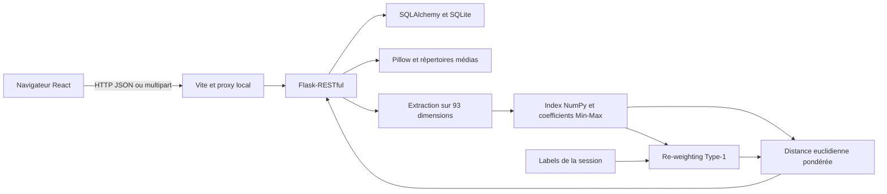

# Architecture du système

Le serveur de développement écoute uniquement sur l’interface de bouclage. Le client envoie le JWT dans l’en-tête d’autorisation, y compris pour récupérer les images affichées. Flask-RESTful expose les groupes de routes documentés dans [api.md](api.md). L’application suppose une galerie commune et des sessions CBIR privées par compte. L’inscription publique est désactivée par défaut.

## Stockage

| Ensemble | Données |
|---|---|
| Comptes et révocations | `users` pour adresses et hachages de mot de passe, `revoked_logins` pour les familles JWT révoquées |
| Catégories et images | `categories.parent_id` forme l’arborescence. `images` référence les catégories et sépare chemins, origine, dimensions et empreinte |
| Dérivés | `images.parent_image_id` et `image_transformations` relient le résultat à l’original et aux paramètres |
| Recherches | `search_sessions`, `feedback_iterations`, `search_history` conservent les séquences et les mesures |
| Fichiers | Corpus, uploads et miniatures dans des dossiers configurables. L’index est `features.npz` |

Un index est un instantané d’IDs triés, de vecteurs bruts et de coefficients de normalisation. Il est remplacé atomiquement. Une mise à jour de la galerie réutilise les vecteurs inchangés et réajuste le Min-Max sur le nouvel ensemble. Le processus Flask vérifie les IDs et drapeaux SQLite avant la recherche et relit l’index si son fichier a changé. Les chemins enregistrés doivent rester valides. Une reconstruction explicite traite les modifications manuelles effectuées sur disque.

Le résultat initial est conservé comme itération 0. Le retour de pertinence récupère les vecteurs du dernier classement, recalcule les poids et le centroïde, puis lance la même recherche pondérée. Une seule application Flask locale coordonne les écritures concurrentes avec un verrou. L’architecture vise le scénario universitaire sur un seul processus.
